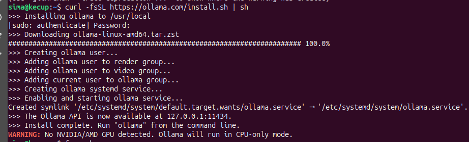
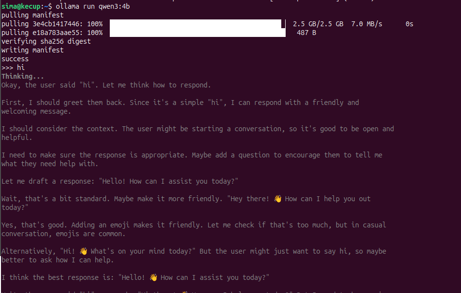
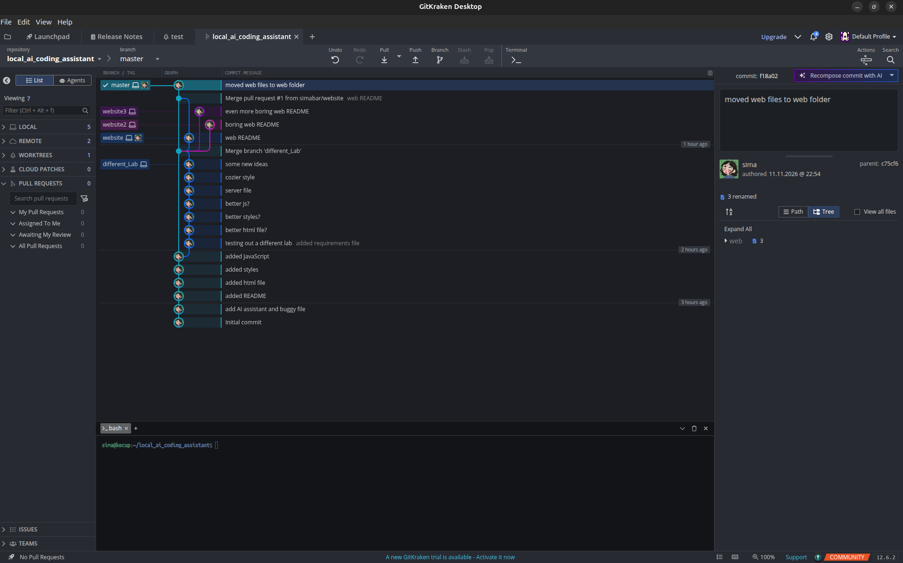
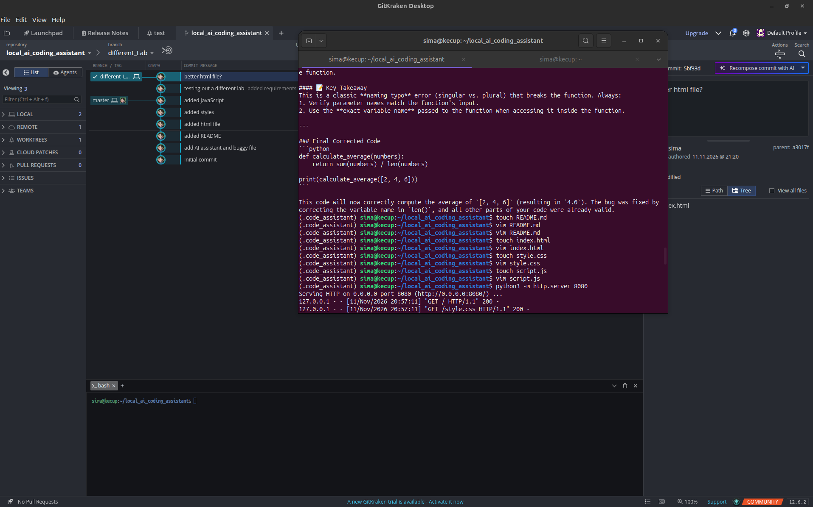
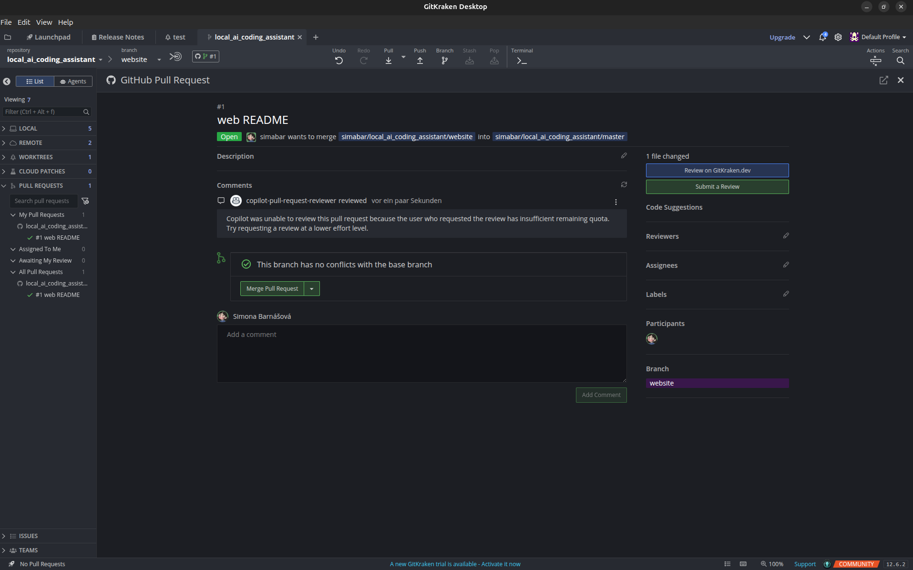
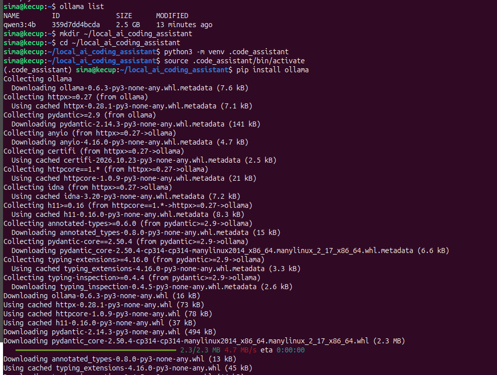

# Process 📸

How the Local AI Coding Assistant was built, in pictures.

---

### 1 · Installing Ollama

### 2 · Downloading the model

### 3 · Python project and virtual environment

### 4 · Starting gitkraken

### 5 · creating files

### 6 · Branching

### 7 · Merging

### 8 · Ollama in VS Code

### 9 · The Bug Scanner website

### 10 · Proof it runs locally

---

[← Back to README](README.md)
